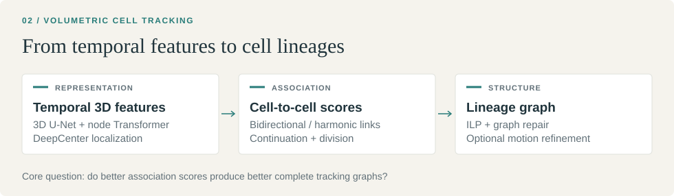

[← All studies](../README.md) &nbsp; / &nbsp; Study 02

# Biohub
### Cell Tracking during Development

| Final Private rank | Best selected Private score ↑ | Medal |
|:---|:---|:---|
| **1,714 / 4,020 teams** | **0.91051** | **None** |

Reconstructing 3D cell lineages from developmental microscopy using temporal
3D U-Nets, node Transformers, a DeepCenter localization prior, and graph
optimization. The best selected result was the baseline replay; adding
collective-motion refinement improved Public but reduced Private performance.

[Models](#models-and-methods) · [Official results](#official-results) · [Recorded resources and costs](#recorded-resources-and-costs) · [Research report](RESEARCH_HISTORY.md) · [Reproduction](REPRODUCIBILITY.md)

## Models and methods

| Component | Model or method | Role |
|---|---|---|
| Temporal representation and association | Temporal 3D U-Net + node Transformer; two public checkpoint variants | Extract image features and score cell associations |
| Auxiliary localization | DeepCenter 3D U-Net | Provide a learned cell-center prior |
| Graph construction | Bidirectional / harmonic association, ILP, and graph repair | Assemble continuation and division relationships |
| Motion refinement | Robust neighborhood-based collective motion | Reconsider eligible continuation edges while retaining nodes and protected division edges |

The neural pipeline adapts the public
[nusrati/0-940 notebook](https://www.kaggle.com/code/nusrati/0-940).
Our original contribution published here is the fixed motion refinement and
its synthetic tests; the report also covers NCC, learned division configurations,
five-frame encoders, self-supervision, and full-graph evaluation.
[Checkpoint sources and redistribution limits](THIRD_PARTY_NOTICES.md).

## Official results

| Pipeline | Public | Private | Final selection |
|---|---:|---:|---|
| Baseline replay / threshold hedge | 0.94094 | **0.91051** | Selected |
| Baseline + collective-motion refinement | **0.94218** | 0.90743 | Selected |
| Later native / learned-division / dense route | 0.938 | 0.904 | Not selected |

The final team rank was **1,714 / 4,020**, with **no medal**.
The first two rows use saved five-decimal submission readbacks; the last uses
saved three-decimal scores. [Official evidence and results](FINAL_RESULTS.md).

## Recorded resources and costs

| Item | Recorded amount | Coverage / interpretation |
|---|---:|---|
| Main-thread model interaction tokens | **5,317,789,093** | July 29–October 22, 2026 UTC; repeated context and follow-up analysis included |
| Cached input, already included above | **5,212,252,288** | Not additional tokens or distinct training examples |
| Selected motion notebook execution | **24.24 min on a Kaggle T4** | One visible run, including 44.38 s motion refinement; not total training/GPU time |
| Preserved motion-component replay | **13.72 s, one CPU allocation** | Preserved visible predictions, no ground-truth labels; not a new benchmark |
| Project-attributable payments / total research compute | **Untracked** | No invoice allocation, complete GPU-hours, or electricity total |

The token snapshot covers the main thread only, not comprehensive subordinate
or advisor usage. Cached input is a subset of input; reasoning is a subset of
output. These are interaction counts, **not a monetary bill**.
Recorded completed-turn wall time was 399.28 h, including 295.65 h of tool waits;
neither figure is active compute time.
[Accounting details, models, time boundaries and gaps](COSTS.md).

## Findings and reproduction

Local improvements did not reliably transfer to complete graphs or hidden-data
scores: a pair model reduced NLL **2.108 → 1.226** while graph score fell
**0.93323 → 0.91967**. Five-frame features and a dense stage learned useful
signals, but the later submitted route remained below the selected baseline.
[Scientific comparisons and validation limits](RESEARCH_HISTORY.md).

- [Official results](FINAL_RESULTS.md) and [31-row experiment table](results/research_results.csv)
- [Reproduction instructions](REPRODUCIBILITY.md) and [motion implementation](src/csv_overlay.py)
- [Source attribution and licenses](THIRD_PARTY_NOTICES.md)

The public code reproduces the motion component and synthetic checks.
Full neural training/inference is not packaged here: it also needs the
referenced source, authorized checkpoints, and competition data.
