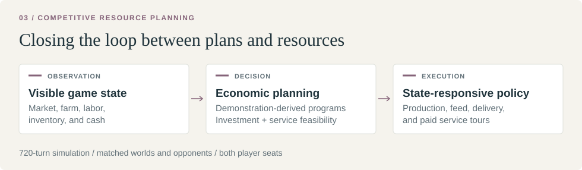

[← All studies](../README.md) &nbsp; / &nbsp; Study 03

# Kaggriculture
### Resource-Constrained Competitive Planning

| Final Private rank | Final Private score | Public rank / skill rating |
|:---|:---|:---|
| **246 / 10,148 · Silver** | **4644.3** | **211 / 10,148 · 2341.9** |

Competitive control in a 720-turn farming simulation with shared markets,
limited labor, and coupled production and transport constraints. The submitted
policies combine demonstration-derived programs with current-state economics
and explicit cash-flow feasibility.

**Outcome.** The official final result is Silver; the original **Gold objective
was not met**. Planning complete production and service programs improved our
local policy: FlexService scored **677 / 768** points against **622 / 768** for
AdaptiveMilk. That panel did not establish strength against the evolving field.

Official locked and verified leaderboard inspected on 22 October 2026, 08:48 UTC. Public skill ratings and final Private Bradley–Terry scores are different scales. Both displayed ranks belong to FlexService; the two controllers are one team.

[Method](#method) · [Results](#results) · [Leading solutions](LEADING_SOLUTIONS.md) · [Research lessons](DESIGN_REVIEW.md) · [Prompt recommendations](PROMPT_RECOMMENDATIONS.md)

## Method

| Model or method | Application | Outcome |
|---|---|---|
| Ridge regression | Select among compatible policy branches from legal current-state features | Limited transfer to new world cohorts |
| ExtraTrees | Nonlinear branch selection | Cohort-held-out performance below the fixed candidate |
| Cross-entropy method (CEM) | Optimize market-control parameters through full-game simulation | Small, opponent-dependent gain; not promoted |
| Demonstration-derived production policies | Compile public action programs into state-responsive production and logistics | Basis of the final submitted controllers |
| AdaptiveMilk economic routing | Evaluate later animal investment using visible market and farm state | Submitted; 636 / 704 local points; final Private 4628.8 |
| FlexService constrained planning | Evaluate complete paid service tours, wages, feed, delivery, and incremental production | Best final submission; 677 / 768 local points; final Private 4644.3 |

The final controllers use deterministic routing and economic forecasts.
The learned selectors were research alternatives. Public demonstrations supplied
offline policy parameters; our modules added material feedback, investment
selection, and service planning. Attribution is documented in
[sources](SOURCES_AND_LICENSES.md).

## Results

The submitted policies were compared on a **shared panel of 32 new initial seeds,
12 opponents, and both seats**:

| Policy | Local points / 768 | Comparison |
|:---|---:|:---|
| **FlexService** | **677** | Constrained service planning |
| AdaptiveMilk | 622 | State-conditioned animal investment |

<strong>Additional confirmation panels</strong>

| Policy | Confirmation panel | Points | Status |
|---|---|---:|---|
| AdaptiveMilk | 32 new worlds × 11 opponents × 2 seats | 636 / 704 | Submitted |
| FlexService | 32 new worlds × 12 opponents × 2 seats | **677 / 768** | Submitted |
| NativeDeadlines | 32 new worlds × 17 opponents × 2 seats | 1055 / 1088 | Local research |
| Committed funding horizon | 64 new worlds × 7 opponents × 2 seats | 843 / 896 | Local research |

The panels differ, so their rates do not directly rank every method.
Committed's 11 additional wins over Flex were all against the earlier
LateFlock policy, exposing a coverage limitation despite its favorable total.

## Validation

Policies were compared on paired initial seeds against responsive local
opponents in both seats. A win contributes 1 point and a draw 0.5. Uncertainty
was grouped by seed because seats and related policy lineages are dependent.
In the native engine, action-dependent weed draws can change later shop draws:
the same initial seed is not a guarantee of identical subsequent shop sequences.
Recent leading opponents were insufficiently represented by this local panel.

## Code and reproduction

- [Research report](RESEARCH.md): model progression, mechanisms, and negative results
- [Results](RESULTS.md): matched comparisons and official observations
- [Reproduction](REPRODUCE.md): exact reconstruction of both submitted policies
- [Retained assets and cleanup](ASSETS.md): what remains runnable and what was removed
- [FlexService code](strategies/flex_service/) and [AdaptiveMilk code](strategies/adaptive_milk/)

Both submitted policies and their inference dependencies are included.
The broader research comparisons also require the original opponent assets.
